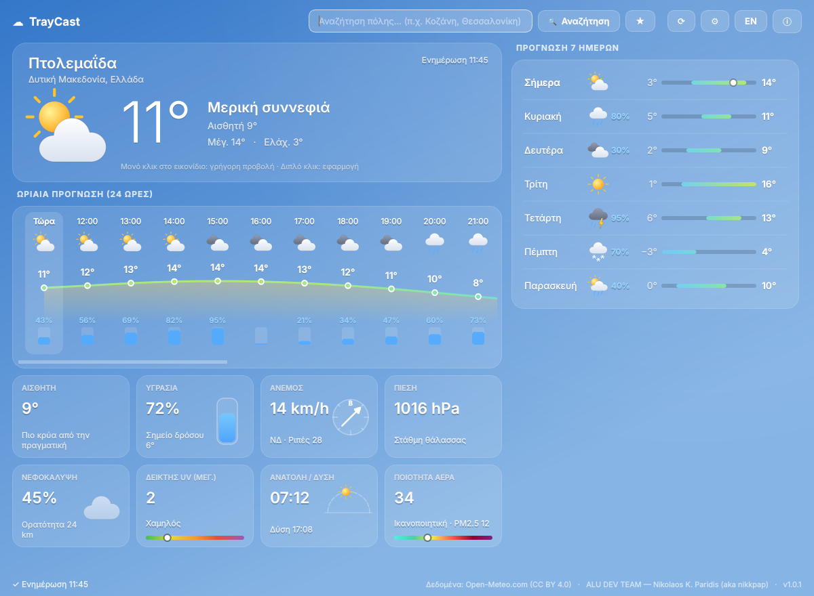
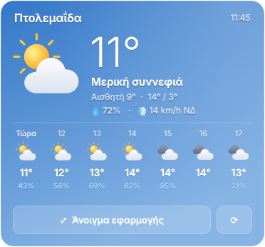

# ☁ TrayCast

**Ο καιρός στη γραμμή εργασιών των Windows.** Δωρεάν δεδομένα από το [Open-Meteo](https://open-meteo.com), χωρίς κλειδί API.

**Weather in your Windows taskbar.** Free data from [Open-Meteo](https://open-meteo.com), no API key needed.

---

## 🇬🇷 Ελληνικά

### Εγκατάσταση (3 βήματα)
1. Εγκατάστησε την [Python 3.10 ή νεότερη](https://www.python.org/downloads/) και τσέκαρε το **«Add Python to PATH»**.
2. Κατέβασε το αρχείο **`TrayCast_v1.0.1.pyw`**.
3. Κάνε **διπλό κλικ** πάνω του. Στην πρώτη εκκίνηση εγκαθιστά μόνο του ό,τι χρειάζεται (PyQt6).

### Χρήση
| Ενέργεια στο εικονίδιο | Αποτέλεσμα |
|---|---|
| **Μονό κλικ** | Γρήγορη προβολή: θερμοκρασία, καιρός, επόμενες ώρες |
| **Διπλό κλικ** | Πλήρης εφαρμογή |
| **Δεξί κλικ** | Μενού: τοποθεσίες, ρυθμίσεις, έξοδος |
| **Μεσαίο κλικ** | Ανανέωση |

### Χαρακτηριστικά
- Θερμοκρασία ή εικονίδιο καιρού πάνω στο εικονίδιο της γραμμής εργασιών
- Ωριαία πρόγνωση 24 ωρών με γράφημα θερμοκρασίας και πιθανότητα βροχής
- Πρόγνωση 7 ημερών
- Αισθητή θερμοκρασία, υγρασία, άνεμος με πυξίδα, πίεση, νεφοκάλυψη, ορατότητα, UV, ανατολή/δύση, ποιότητα αέρα
- Αναζήτηση οποιασδήποτε πόλης, λίστα πρόσφατων τοποθεσιών
- °C/°F, km/h · m/s · mph · knots, Ελληνικά/English
- Ειδοποίηση όταν έρχεται βροχή
- Εκκίνηση μαζί με τα Windows (προαιρετικά)

### 💡 Windows 11: το εικονίδιο δεν φαίνεται;
Τα νέα εικονίδια κρύβονται στο βελάκι **^**. Σύρε το TrayCast δίπλα στην ένδειξη γλώσσας,
ή άνοιξε **Ρυθμίσεις → Εξατομίκευση → Γραμμή εργασιών → Άλλα εικονίδια γραμμής εργασιών** και ενεργοποίησέ το.

---

## 🇬🇧 English

### Install
1. Install [Python 3.10+](https://www.python.org/downloads/) (tick **"Add Python to PATH"**).
2. Download **`TrayCast_v1.0.1.pyw`**.
3. **Double-click** it. On first run it installs its own dependencies (PyQt6).

### Usage
**Single click** the tray icon for a quick view · **Double click** for the full app · **Right click** for the menu · **Middle click** to refresh.

### Files
Settings and cache are stored in `%APPDATA%\TrayCast\`.

---

Weather data by [Open-Meteo.com](https://open-meteo.com) (CC BY 4.0).

**Developer:** Nikolaos K. Paridis (aka nikkpap) — ALU DEV TEAM
